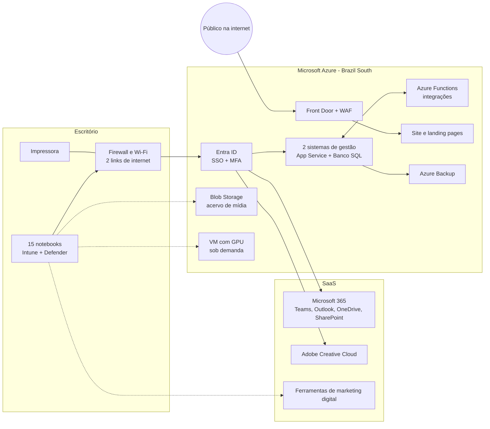

# Proposta

Conversamos sobre aspectos iniciais de nuvem e infraestrutura. Agora vamos imaginar uma situação para análise.

Você foi contratado para trabalhar com TI em uma pequena empresa de marketing, com 15 funcionários e que ainda não foi aberta oficialmente, porque estão terminando de montar o espaço físico.

Gift em breve

A empresa começará de forma simples, com os colaboradores utilizando notebooks. Será preciso garantir a comunicação entre colaboradores, além de dois sistemas internos de gestão para uso com outros softwares, soluções de segurança e espaço para armazenamento de arquivos.

Além do marketing tradicional, como campanhas publicitárias, impressões etc., também criará conteúdo para a internet e tudo que é relacionado ao marketing digital.

O diretor fala para você pensar em uma estratégia de TIC na nuvem, pensando nessa estratégia de marketing da empresa, em limite no orçamento, ou seja, o que tiver que ser contratado, será!

Você avalia os provedores de nuvem disponíveis no mercado e escolhe um como base.

Mas quais recursos computacionais você acredita que seriam necessários para montar toda uma infraestrutura de TI para fazer a empresa funcionar?

# Solução

## 1. O que a empresa precisa

Do enunciado, tiro sete necessidades:

1. **Equipamento de trabalho:** 15 colaboradores usando notebooks.
2. **Comunicação** entre os colaboradores.
3. **Dois sistemas internos de gestão**, integrados a outros softwares.
4. **Segurança.**
5. **Armazenamento de arquivos.**
6. **Marketing tradicional:** campanhas e impressões.
7. **Marketing digital:** produção de conteúdo para a internet e publicação.

Duas premissas guiam a proposta:

- **O orçamento não tem limite.** Posso escolher a melhor solução em vez da mais barata. Mesmo assim, tudo na nuvem gera custo, então incluo controle de gastos para evitar desperdício.
- **A empresa ainda não abriu.** Não há servidor nem sala técnica para herdar, então ela pode nascer na nuvem. Montar servidores próprios exigiria comprar hardware, nobreak e refrigeração, além de cuidar de manutenção e peças de reposição. Para uma empresa de 15 pessoas, isso é custo e risco sem retorno.

## 2. Provedor escolhido e estratégia

**Escolhi a Microsoft como base: o Microsoft Azure junto com o Microsoft 365.** Os motivos:

- **Uma identidade só para tudo.** A mesma conta do colaborador (Microsoft Entra ID) dá acesso ao e-mail, ao Teams, aos arquivos, aos sistemas internos e aos recursos do Azure.
- **Região no Brasil.** A região Brazil South fica em São Paulo e traz duas vantagens:
  - **Latência baixa** para uma equipe que trabalha no Brasil.
  - **LGPD:** os dados pessoais de clientes e de *leads* das campanhas ficam no país.
- **Todos os modelos de serviço** em um só fornecedor: SaaS, PaaS, IaaS e FaaS.

A AWS e o Google Cloud (com o Google Workspace) também atenderiam. A escolha pesa pela integração entre produtividade, identidade e nuvem.

A estratégia segue três regras:

1. **SaaS sempre que existir um produto pronto.** É o modelo que menos exige da equipe de TI, que nesta empresa sou só eu.
2. **PaaS para o que for próprio da empresa**, como sistemas desenvolvidos sob medida.
3. **IaaS só onde for preciso controlar a máquina**, como numa VM com placa de vídeo para renderização.

O resultado é uma **nuvem pública** como base, com uma **infraestrutura local mínima** no escritório: rede, internet, notebooks e impressora.

## 3. Recursos necessários

### 3.1 Identidade e acesso: a base de tudo

- **Microsoft Entra ID**, com uma conta por colaborador.
  - **Login único (SSO)** em todos os serviços.
  - **MFA (autenticação em dois fatores)** obrigatória para todos.
- **Acesso condicional:** por exemplo, só notebooks da empresa, cadastrados e em conformidade, acessam os sistemas de gestão.
- **Grupos de permissão** por área (criação, atendimento, financeiro, diretoria), para que cada pessoa veja só o que precisa.

### 3.2 Comunicação e produtividade (SaaS)

Contrato o **Microsoft 365 Business Premium** para os 15 colaboradores. Ele inclui:

- **Outlook / Exchange Online:** e-mail com o domínio próprio da empresa (ex.: `nome@agencia.com.br`).
- **Teams:** chat, reuniões e videochamadas com a equipe e com clientes, e canais por cliente ou campanha. Se a empresa quiser número fixo, o **Teams Phone** é contratado à parte e faz a telefonia VoIP pelo próprio Teams.
- **Word, Excel e PowerPoint**, na versão desktop e na web, para propostas, relatórios e apresentações.

O mesmo plano também traz o **OneDrive**, o **SharePoint**, o **Intune** e o **Defender**, que aparecem nas seções seguintes.

### 3.3 Armazenamento de arquivos

| Tipo de arquivo | Onde fica | Por quê |
|---|---|---|
| Arquivos pessoais de trabalho | **OneDrive** (1 TB por usuário) | Sincroniza com o notebook e funciona de qualquer lugar |
| Arquivos da empresa e dos clientes (briefings, contratos, peças em produção) | **SharePoint**, com um site por área e uma biblioteca por cliente | Permissões por grupo, versionamento e compartilhamento com o cliente por link com prazo de validade, sem mandar anexo pesado por e-mail |
| Acervo pesado: vídeos brutos, fotos em alta resolução, campanhas encerradas | **Azure Blob Storage**, nas camadas *hot* (quente), *cool* (fria) e *archive* (arquivo) | Arquivo de campanha antiga vai para a camada de arquivo, que é muito mais barata, e continua recuperável |

### 3.4 Os dois sistemas internos de gestão

Imagino um **sistema financeiro** (faturamento, contas e notas fiscais) e um **sistema de gestão de projetos e clientes** (campanhas, prazos e aprovações). Há dois caminhos.

- **Se existir um sistema pronto no mercado que atenda:** contrato como **SaaS**. Assim não preciso cuidar de servidor, atualização nem backup.
- **Se forem sistemas próprios ou personalizados**, monto em **PaaS** no Azure:
  - **Aplicativo Web (App Service):** hospeda cada sistema, sem que eu precise administrar sistema operacional.
  - **Banco de Dados SQL do Azure:** guarda os dados, com backup automático.
  - **Aplicativo de Funções (FaaS):** faz as integrações entre os sistemas e com outros softwares. Por exemplo, quando uma campanha é aprovada no sistema de projetos, uma função gera a cobrança no financeiro.
  - **Login pelo Entra ID:** só colaboradores autenticados acessam, e nada fica aberto na internet sem senha.
- **Se algum sistema for de fornecedor e exigir servidor próprio:** uso uma **máquina virtual (IaaS)** com a configuração (*sizing*) indicada pelo fornecedor, para não perder o suporte.

Como são só 15 usuários, começo com os tamanhos menores e ajusto conforme as métricas de uso.

### 3.5 Criação de conteúdo e marketing digital

| Necessidade | Recurso | Modelo |
|---|---|---|
| Edição de imagem, vídeo e diagramação para peças digitais e impressas | **Adobe Creative Cloud** (Photoshop, Illustrator, Premiere, InDesign) | SaaS |
| Renderização pesada de vídeo | **VM com GPU** (série N do Azure), ligada **só quando houver renderização** e desligada depois | IaaS |
| Site institucional, portfólio e *landing pages* das campanhas | **Azure App Service** ou **Static Web Apps** | PaaS |
| Entrega rápida e protegida do site e das *landing pages* | **Azure Front Door** com **CDN** e **WAF** (*web application firewall*) na frente | PaaS |
| Domínio e DNS | Registro `.com.br` no Registro.br e **Azure DNS** | SaaS |
| E-mail marketing, agendamento em redes sociais e métricas de campanha | Ferramentas especializadas, como RD Station, mLabs e Google Analytics | SaaS |
| Relatórios de resultados para clientes | **Power BI** | SaaS |

Os formulários das *landing pages* coletam dados pessoais de *leads*, por isso ficam na região Brazil South, por causa da LGPD.

### 3.6 Segurança

- **Notebooks:**
  - **Intune** gerencia os 15 notebooks: aplica as políticas da empresa, criptografa o disco com BitLocker e permite apagar os dados remotamente em caso de perda ou roubo.
  - **Microsoft Defender for Business** é o antivírus com detecção e resposta (EDR) em cada notebook.
- **E-mail:** o **Defender for Office 365** filtra phishing e anexos maliciosos, que são a porta de entrada mais comum de ataques.
- **Contas:** MFA e acesso condicional, descritos na seção 3.1.
- **Site e sistemas expostos:** ficam atrás do **WAF** do Front Door, contra ataques web.
- **LGPD:** as políticas de proteção de dados do **Microsoft Purview** impedem que dados sensíveis de clientes saiam da empresa, por exemplo num compartilhamento externo indevido.
- **Backup:**
  - **Azure Backup** cobre os bancos e as VMs.
  - O **Microsoft 365 Backup** cobre e-mail, OneDrive e SharePoint.
  - Os backups ficam num **grupo de recursos separado** do ambiente de produção. Assim, apagar o grupo da aplicação não apaga os backups junto.

### 3.7 Infraestrutura local: o que fica no escritório

- **Dois links de internet de operadoras diferentes.** Com tudo na nuvem, a internet é o recurso mais crítico: se um link cair, o outro mantém a empresa funcionando.
- **Firewall/roteador**, **switch** e **pontos de acesso Wi-Fi**, com uma rede para os colaboradores e outra, isolada, para visitantes e clientes.
- **Nobreak** para os equipamentos de rede.
- **15 notebooks em dois perfis:**
  - **Administrativo e atendimento:** configuração padrão.
  - **Criação:** mais memória RAM, placa de vídeo dedicada e tela com boa reprodução de cores, para design e vídeo.
- **Impressora multifuncional colorida** na rede, para provas e materiais internos. As impressões grandes das campanhas vão para gráficas parceiras.

### 3.8 Gestão, monitoramento e custos

Mesmo sem limite de orçamento, nada deve ficar ligado sem uso. Por isso:

- **Azure Cost Management** com **orçamentos e alertas de gasto**.
- **Tags** (marcas) por cliente e por projeto em cada recurso. Assim dá para saber quanto cada cliente custa em nuvem e repassar esse custo nas propostas.
- **Desligamento automático da VM com GPU** fora do uso.
- **Azure Monitor** com alertas de disponibilidade e desempenho dos sistemas de gestão e do site.

## 4. Visão geral da arquitetura

| Necessidade | Recurso | Modelo | Onde |
|---|---|---|---|
| Identidade e acesso | Microsoft Entra ID (SSO, MFA, acesso condicional) | SaaS | Nuvem pública |
| Comunicação | Teams e Outlook (Microsoft 365) | SaaS | Nuvem pública |
| Arquivos do dia a dia | OneDrive e SharePoint | SaaS | Nuvem pública |
| Acervo de mídia | Azure Blob Storage | PaaS | Azure (Brazil South) |
| Sistemas de gestão | SaaS de mercado, ou App Service + Banco SQL | SaaS ou PaaS | Nuvem pública / Azure |
| Integrações | Azure Functions | FaaS | Azure (Brazil South) |
| Criação de conteúdo | Adobe Creative Cloud | SaaS | Nuvem pública |
| Renderização pesada | VM com GPU sob demanda | IaaS | Azure |
| Site e *landing pages* | App Service + Front Door com WAF | PaaS | Azure |
| Segurança dos notebooks | Intune e Defender for Business | SaaS | Nuvem pública + notebooks |
| Backup | Azure Backup e Microsoft 365 Backup | PaaS / SaaS | Azure |
| Rede, internet e impressão | Dois links, firewall, Wi-Fi e impressora | — | Local (escritório) |

## 5. Ordem de implantação, antes da inauguração

1. **Domínio e identidade:** registrar o domínio, criar o ambiente do Microsoft 365 e do Azure e as contas com MFA.
2. **Escritório:** instalar os links de internet, o firewall, o Wi-Fi e a impressora.
3. **Notebooks:** cadastrar no Intune, que já entrega cada máquina configurada, criptografada e com antivírus.
4. **Arquivos e comunicação:** estruturar o SharePoint por área e cliente e os canais do Teams.
5. **Sistemas:** contratar ou publicar os dois sistemas de gestão e as integrações, e testar com a equipe antes da abertura.
6. **Marketing digital:** publicar o site e configurar as ferramentas de marketing.
7. **Proteção e custos:** ativar os backups, os alertas de monitoramento e os orçamentos de custo.

## 6. Conclusão

A empresa não precisa de nenhum servidor físico. A infraestrutura local se resume à rede, aos notebooks e à impressora, e o resto vem da nuvem:

- **SaaS** para comunicação, arquivos, criação e marketing;
- **PaaS e FaaS** para os sistemas de gestão e o site;
- **IaaS** só para a renderização pesada, ligada sob demanda.

Escolhi a região do Brasil pela latência e pela LGPD. A segurança entra em camadas: identidade, notebooks, e-mail, site e backup. Mesmo sem limite de orçamento, tags e alertas de custo garantem que se pague só pelo que é usado. Como tudo é contratado sob demanda, a estrutura cresce junto com a empresa: um colaborador novo é uma licença a mais, e um cliente novo é uma biblioteca e uma tag a mais.