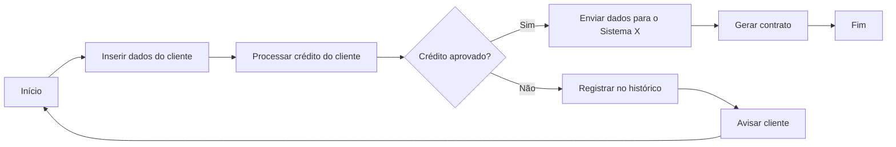
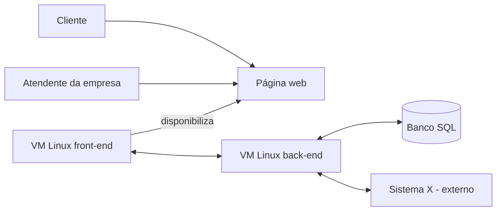
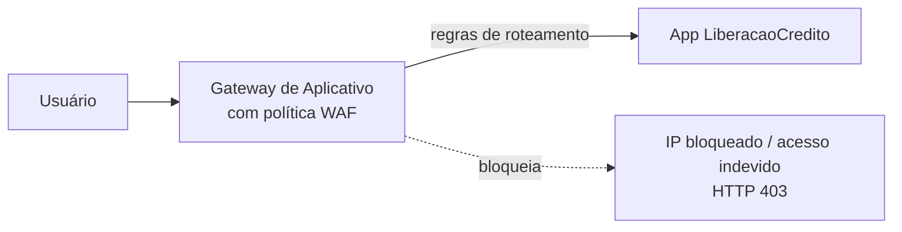

# Resumo — Cloud Computing

Resumo de estudo das 8 unidades da disciplina **Cloud Computing** (PUCPR EAD). Ele segue a ordem do material e usa os mesmos exemplos do professor.

**Como usar este resumo**

- Cada unidade termina com perguntas de fixação. A resposta fica escondida: tente responder antes de abrir.
- Os trechos marcados com **Nota do resumo** não estão nos PDFs. São complementos que explicam termos que o material só cita ou que ligam uma unidade à outra.
- Os vídeos não fazem parte dos PDFs. Quando um tema só aparece no vídeo, o resumo avisa.

## Sumário

| Unidade | Tema | PDF |
|---|---|---|
| — | [A ideia central da disciplina](#a-ideia-central-da-disciplina) | — |
| 1 | [A nuvem e os modelos de serviço](#unidade-1-a-nuvem-e-os-modelos-de-serviço) | [PDF](1-A%20nuvem%20que%20%C3%A9%20feita%20de...%20bits%20e%20bytes.pdf) |
| 2 | [TIC, Azure e tipos de nuvem](#unidade-2-tic-tecnologia-da-informação-e-comunicação-azure-e-tipos-de-nuvem) | [PDF](2-TIC%20na%20ess%C3%AAncia%20da%20nuvem.pdf) |
| 3 | [Provisionamento e dimensionamento](#unidade-3-provisionamento-e-dimensionamento) | [PDF](3-Provisionando%20na%20nuvem%20o%20provisionamento%20do%20papel.pdf) e [infográfico](3.1-Provisionando%20na%20nuvem%20o%20provisionamento%20do%20papel.pdf) |
| 4 | [O sistema na nuvem (prática no Azure)](#unidade-4-o-sistema-na-nuvem-prática-no-azure) | [PDF](4-sistema%20l%C3%A1%20na%20nuvem.pdf) |
| 5 | [Gerenciamento e monitoramento](#unidade-5-gerenciamento-e-monitoramento) | [PDF](5-Gerenciar%20o%20gerenciamento%20e%20monitorar%20o%20monitoramento.pdf) |
| 6 | [Segurança com WAF e o custo dela](#unidade-6-segurança-com-waf-e-o-custo-dela) | [PDF](6-Protegendo%20seus%20custos%20com%20firewall%20e%20login.pdf) |
| 7 | [Alta disponibilidade](#unidade-7-alta-disponibilidade) | [PDF](7-Traga%20mais%20servidores%20e%20sua%20carteira.pdf) |
| 8 | [O caso CrowdStrike e o fechamento](#unidade-8-o-caso-crowdstrike-e-o-fechamento) | [PDF](8-Cinco%20bilh%C3%B5es%20de%20d%C3%B3lares%20perdidos%20por%20um%20update%20na%20nuvem.pdf) |
| — | [Tudo na nuvem custa: as lições de custo](#tudo-na-nuvem-custa-as-lições-de-custo) | — |
| — | [Glossário](#glossário) | — |

---

## A ideia central da disciplina

A disciplina tem três fios que atravessam todas as unidades:

1. **Tudo na nuvem custa.** O professor repete em quase toda aula: cada recurso criado, cada opção marcada e cada recurso esquecido ligado viram cobrança. Mais adiante aparece o outro lado, o custo de ficar fora do ar (Unidade 8).
2. **Não existe receita pronta.** Região, tamanho de VM, redundância e segurança dependem das necessidades do negócio. O trabalho é levantar essas necessidades, montar um raciocínio e comprová-lo, com um piloto ou com métricas.
3. **Um projeto acompanha o curso.** A partir da Unidade 3, os conceitos são aplicados a um **sistema web de liberação de crédito**, implantado no Microsoft Azure com o nome `LiberacaoCredito`.

O provedor usado nas aulas é o **Microsoft Azure**, parceiro da PUCPR, por meio da conta Azure for Students (crédito de US$ 100). AWS e Google Cloud aparecem como comparação. Toda a prática é feita pelo portal web do Azure.

---

## Unidade 1: a nuvem e os modelos de serviço

### O problema que a nuvem resolve

Imagine que você criou um site (no exemplo do material, um e-commerce de produtos personalizados com IA) e precisa colocá-lo no ar. Sem nuvem, você teria de cuidar de tudo:

- comprar o hardware e mantê-lo ligado 24 horas por dia;
- garantir internet estável e energia (nobreak);
- cuidar do resfriamento, para a máquina não superaquecer;
- ter dinheiro e agilidade para trocar peças, ou já ter um servidor reserva;
- cuidar de segurança, manutenção e escalabilidade, caso o site cresça.

Se esse site é sua fonte de renda, ficar 1, 2 ou 5 dias fora do ar tem impacto financeiro direto. A nuvem resolve isso: você paga uma assinatura mensal ou paga pelo uso de cada recurso, e o provedor cuida da manutenção, da energia e da troca de peças.

**Provedor de nuvem** é a empresa que gerencia os recursos computacionais e os disponibiliza para uso de qualquer lugar com internet. Os principais são **Microsoft Azure**, **Amazon AWS** e **Google Cloud Platform**. Cada um tem seu próprio modelo de gestão e de cobrança.

A ideia de usar recursos computacionais sem tê-los fisicamente por perto é bem mais antiga do que a popularização recente da nuvem. O histórico é contado na videoaula.

### Os três modelos clássicos: IaaS, PaaS e SaaS

Os modelos surgiram para oferecer **níveis diferentes de controle e de praticidade**. Quanto mais o provedor entrega pronto, menos você controla e menos você precisa cuidar.

| Modelo | O que o provedor entrega | O que fica com você | Exemplo do material |
|---|---|---|---|
| **IaaS** (infraestrutura como serviço) | Um servidor "cru", com o hardware que você escolher (ex.: CPU de 8 núcleos a 5 GHz, 32 GB de RAM, 1 TB de SSD) | Instalar e atualizar o sistema operacional, configurar tudo e resolver falhas de software | Máquinas virtuais criadas e destruídas sob demanda para testes |
| **PaaS** (plataforma como serviço) | Hardware **e** sistema operacional prontos e mantidos. Você não acessa o SO nem o hardware diretamente | Instalar e configurar só o que a aplicação precisa | Servidor que já vem com PHP, os módulos e o banco local: basta subir os arquivos. Também Google Firebase e Heroku |
| **SaaS** (software como serviço) | O software pronto, acessado pela internet | Só usar | Photoshop on-line (Adobe Creative Cloud), Google Drive, Dropbox, OneDrive |

Detalhes que o material destaca:

- No **IaaS**, a vantagem é não se preocupar com queda de energia, peças e falhas de hardware. Todo o resto (instalação, atualização e falhas do sistema) é sua responsabilidade.
- O **PaaS** é muito comum entre desenvolvedores: ele dá a base para rodar a aplicação e deixa liberdade para instalar o que for preciso.
- No **SaaS**, a infraestrutura do fornecedor fica "por trás das cortinas". Você não precisa de um computador potente para rodar o software localmente.

### Outros modelos: FaaS e CaaS

IaaS, PaaS e SaaS são os mais famosos por terem sido os primeiros, mas há outros muito usados hoje:

- **FaaS (função como serviço):** você coloca na nuvem **apenas uma função**. Se uma parte específica do sistema consome muito do servidor, você a manda para um FaaS, que processa e devolve o resultado. Assim o servidor fica mais leve. Na Unidade 4 isso aparece na prática como *Aplicativo de Funções* do Azure.
- **CaaS:** só é citado. O material diz que será visto depois, mas nenhuma unidade volta a ele.

> **Nota do resumo:** CaaS é *containers como serviço*. O provedor gerencia a execução e a orquestração de containers (por exemplo, um Kubernetes gerenciado), e você entrega a aplicação empacotada em containers. Fica entre o IaaS (você cuida do SO) e o PaaS (você não vê o SO).

### Os modelos se combinam

Optar por PaaS não prende você a ele. Dá para usar PaaS e mandar uma função pesada para um FaaS, por exemplo. A computação em nuvem é um "mar vasto" de recursos que se combinam conforme o que você realmente precisa consumir. Para soluções avançadas existem **certificações** dos provedores, que muitas empresas exigem, principalmente para quem trabalha como DevOps.

Esses três modelos são conceitos mundiais: valem em qualquer lugar e em qualquer provedor.

### Exercício comentado da unidade

| Situação | Resposta | Por quê |
|---|---|---|
| 1. Time de dev precisa de site dinâmico com banco relacional, escala automática e versionamento, sem gerenciar servidor ou SO, mas instalando as próprias ferramentas | **PaaS** | Plataforma pronta (SO, servidores, banco), com escala automática; o time foca no código |
| 2. Empresa quer guardar e editar documentos em conjunto, de qualquer dispositivo, sem gerenciar infraestrutura | **SaaS** | Google Drive, Dropbox e OneDrive são o exemplo clássico |
| 3. Automatizar processos de TI com processamento de dados em grande escala, funções independentes, sem configurar servidores, aguentando picos | **FaaS** | Funções pequenas, executadas sob demanda, que escalam sozinhas |
| 4. Produtora quer editor de vídeo profissional acessível de qualquer lugar, sem instalar e sem licença tradicional, com arquivos na nuvem | **SaaS** | Ex.: Adobe Creative Cloud |
| 5. Time precisa de VMs com processador e memória específicos, criadas e destruídas rapidamente para testar SOs e softwares | **IaaS** | Acesso direto ao hardware virtualizado, configurável |
| 6. Startup cria app móvel e precisa de back-end pronto (banco, autenticação, APIs), focando na interface | **PaaS** | Ex.: Google Firebase e Heroku |

Leitura indicada pelo material: [Google Cloud — PaaS x IaaS x SaaS x CaaS](https://cloud.google.com/learn/paas-vs-iaas-vs-saas?hl=pt-BR).

### Para fixar

<details>
<summary>1. Em qual modelo você é responsável por atualizar o sistema operacional?</summary>

No **IaaS**. O provedor cuida só do hardware (energia, peças, falhas físicas). No PaaS e no SaaS, o SO é responsabilidade do provedor.
</details>

<details>
<summary>2. Por que mandar uma função para um FaaS em vez de deixá-la no servidor?</summary>

Para tirar do servidor um processamento pesado e específico. O FaaS executa a função sob demanda e devolve o resultado, e o servidor fica mais leve.
</details>

---

## Unidade 2: TIC (Tecnologia da Informação e Comunicação), Azure e tipos de nuvem

A unidade conecta **TIC** à nuvem e mostra que quase todo recurso de TI de uma empresa pode vir da nuvem. Também apresenta o Azure e os critérios para decidir **onde** colocar cada recurso.

### O portal do Azure

O portal do Azure organiza os recursos em muitas categorias, cada uma com vários serviços. O material dá exemplos do que existe lá:

- montar toda a rede da empresa na nuvem (colaboradores, servidores, telefonia, sistemas, armazenamento);
- criar um sistema de telefonia VoIP;
- desenvolver em Node.js;
- criar uma máquina virtual Linux e acessá-la pelo navegador.

### Criando uma VM: tudo é configurável, e tudo custa

A VM fica na categoria **Computação**. Na criação, há duas opções:

- **configuração simplificada:** escolher um modelo com especificações predefinidas;
- **configuração personalizada:** escolher sistema operacional, tipo de disco, processador, memória RAM, velocidade de rede, método de autenticação, segurança, integração com redes corporativas, IP fixo ou dinâmico, backup, entre outras opções.

**Cada configuração incide em custo.** "Não existe almoço grátis na nuvem." O provedor mostra uma **estimativa** de custo ao configurar o recurso, mas é só uma previsão, não o valor final. Os provedores também têm ferramentas de gestão de custos.

### Licença própria

Um servidor com Windows custa mais, porque a licença do Windows vem embutida. Se você já tem a licença, pode usá-la em vez da licença da nuvem. O mesmo vale para licenças de banco de dados, de softwares de desenvolvimento e outras.

> **Nota do resumo:** no mercado, isso é chamado de *BYOL* (*bring your own license*). No Azure, o nome comercial é *Azure Hybrid Benefit*.

### Localização geográfica: custo × latência × LGPD

A região onde o recurso fica (EUA, Brasil etc.) pesa em três aspectos:

| Aspecto | O que muda |
|---|---|
| **Custo** | Cada região tem preço diferente. No Brasil é mais caro, por causa dos impostos |
| **Latência** | Recurso perto do usuário (ou dos outros recursos) responde mais rápido |
| **LGPD / GDPR** | Algumas leis proíbem guardar certos dados fora do país de origem. É preciso validar com o time de privacidade de dados |

Exemplo de latência do material: dois sistemas, um em VM no Brasil e outro em VM nos EUA, levam cerca de **1 segundo** para trocar informações. Integrando duas VMs no Brasil, o tempo cai para cerca de **1 milissegundo**. Muitas vezes a decisão é escolher entre pagar mais com latência baixa ou pagar menos com latência alta.

### Tipos de nuvem

Algumas empresas adotam uma **estratégia híbrida**, com recursos na nuvem, recursos em servidores locais (físicos) e até uma nuvem privada. Os motivos podem ser a LGPD, a latência, os custos ou sistemas que precisam estar no local, como os de maquinário industrial. A escolha depende da estratégia da empresa junto com o time de TI.

**Glossário da aula** (infográfico da p. 12):

| Termo | Definição |
|---|---|
| **Nuvem pública** | Serviços de computação oferecidos pela internet, que qualquer usuário que conheça a localização do serviço pode acessar. Recursos escaláveis e sob demanda, em geral pagos conforme o uso |
| **Nuvem privada** | Infraestrutura de nuvem operada **exclusivamente para uma única organização**, gerenciada por ela ou por terceiros e hospedada internamente ou fora. Dá mais controle sobre dados e recursos; é indicada para quem precisa de muita segurança e privacidade. A empresa vira "provedora de nuvem" só para si, sem comercializar |
| **Nuvem híbrida** | **Combinação de nuvens públicas e privadas que operam de forma integrada**, de modo que dados e aplicativos são compartilhados entre elas. Dá mais flexibilidade e mais opções de implantação: a organização ajusta a TI a cada demanda. O texto da unidade usa o termo de forma mais ampla e inclui também os servidores locais na combinação |
| **Servidores locais** (*on-premises*) | Computadores de alta capacidade que fornecem serviços, arquivos ou aplicações a uma rede local (LAN): e-mail, hospedagem de sites, firewall, proxy, impressão, banco de dados, controlador de domínio |
| **Infraestrutura de nuvem** | Os **componentes de hardware e software** usados para fornecer nuvem pela internet: servidores, armazenamento, equipamentos de rede e tecnologias de virtualização. É o que permite ao provedor oferecer recursos escaláveis e sob demanda |

### Como escolher: nuvem pública, infraestrutura local ou nuvem privada

O infográfico da p. 10 compara as três opções com um exemplo cada. A decisão depende de custo, segurança, controle e flexibilidade.

| | **Nuvem pública** | **Infraestrutura local** (*on-premises*) | **Nuvem privada** |
|---|---|---|---|
| **Quem escolhe** | Uma *startup* de tecnologia que precisa escalar rápido e com flexibilidade | Uma grande empresa financeira, como um banco, com dados altamente confidenciais e regulados | Uma multinacional que precisa de mais controle e segurança do que a nuvem pública oferece, mas não quer lidar com a complexidade de manter uma infraestrutura local |
| **Exemplo de solução** | Serviços de IaaS da AWS, do Google Cloud ou do Azure, pagando só pelo uso | Manter os próprios servidores na empresa | IBM Cloud Private ou Microsoft Azure Stack, que criam um ambiente de nuvem privada **dentro do data center da empresa** |
| **Critério 1** | **Custo e escalabilidade:** escalar recursos rapidamente conforme a demanda, sem grandes investimentos em infraestrutura | **Controle total** sobre infraestrutura, dados e segurança | **Segurança e controle com mais flexibilidade:** o controle de uma infraestrutura local com a flexibilidade e a escalabilidade de uma nuvem pública |
| **Critério 2** | **Menor investimento inicial:** paga-se só pelo uso, sem comprar servidores | **Segurança e conformidade:** dados sensíveis ou regulamentados (financeiros, de saúde) ficam no local para cumprir LGPD, GDPR ou normas do setor | **Requisitos muito específicos** das cargas de trabalho, como alto nível de personalização em segurança e redes |
| **Considerações** | Menos controle sobre a infraestrutura e menos personalização da segurança, porque o provedor cuida do hardware e da rede | Investimentos altos em hardware, manutenção e pessoal especializado, e mais responsabilidade pela gestão e pela segurança | Exige investimento inicial em hardware e pessoal, mas dá mais controle sobre segurança e personalização. Junta os benefícios da nuvem com os controles da infraestrutura local |

Repare na progressão: a nuvem pública dá o máximo de flexibilidade com o mínimo de controle, a infraestrutura local dá o máximo de controle com o máximo de responsabilidade, e a nuvem privada fica no meio.

### Case: transformação digital no agronegócio

Uma empresa média de tecnologia para o agronegócio monta uma arquitetura que mistura tudo:

| Necessidade | Onde fica | Por quê |
|---|---|---|
| Dados sensíveis (previsão de safra, algoritmos de análise de solo, dados financeiros de clientes) | **Nuvem privada** | Controle total e conformidade |
| Site institucional, suporte ao cliente e análises climáticas para produtores | **Nuvem pública** (Azure) | Custo menor e escala conforme a demanda |
| Dados de sensores IoT nas fazendas | Processados na **pública**, guardados na **privada** | É o modelo **híbrido**: eficiência e proteção ao mesmo tempo |
| Autenticação de funcionários e gestão de impressão | **Servidores locais** na matriz | Menor latência na rede interna |

Decisões de região tomadas no case:

- **Custo:** hospedar nos EUA ou na Europa pode sair mais barato, mas tem taxas de transferência entre regiões e mais latência. No Brasil é um pouco mais caro, mas reduz a taxa de saída de dados (*egress*) para clientes nacionais. **Decisão:** serviços menos críticos, como páginas públicas, ficam fora do país; dados sensíveis ficam no Brasil.
- **Latência:** IoT e análises em tempo real precisam de latência baixa, então ficam no Brasil. Relatórios administrativos toleram latência, então podem ficar nos EUA.
- **LGPD:** dados pessoais de clientes brasileiros ficam só no Brasil, com políticas que impedem transferência não autorizada entre regiões. Servidores fora do país processam apenas dados agregados e não identificados.

### Multicloud

Dá para usar um recurso do Azure integrado a outro da AWS, conforme o caso. Combinar provedores faz parte da estratégia de várias empresas.

### Para fixar

<details>
<summary>1. Quais são os três aspectos afetados pela escolha da região?</summary>

**Custo** (cada região tem um preço), **latência** (distância até o usuário e entre recursos) e **legislação de dados** (LGPD/GDPR).
</details>

<details>
<summary>2. Qual a diferença entre nuvem privada e servidores locais?</summary>

Servidores locais são máquinas físicas que atendem a rede local. A nuvem privada é uma *infraestrutura de nuvem* (com virtualização, recursos sob demanda etc.) operada só para uma organização; pode estar no prédio da empresa ou fora dele.
</details>

<details>
<summary>3. Uma multinacional quer mais controle e segurança do que a nuvem pública oferece, mas não quer a complexidade de manter infraestrutura local. Qual opção, e qual o custo dela?</summary>

**Nuvem privada** (ex.: Microsoft Azure Stack ou IBM Cloud Private no data center da empresa). Ela dá o controle da infraestrutura local com a flexibilidade da nuvem, mas exige investimento inicial em hardware e pessoal.
</details>

---

## Unidade 3: provisionamento e dimensionamento

O objetivo da unidade é **planejar antes de criar**: mapear os recursos de que um projeto precisa e estimar o tamanho deles, antes de gastar créditos na nuvem.

### O projeto de referência

A partir desta unidade, tudo gira em torno de um **sistema web de liberação de crédito**. O fluxo macro (p. 4):



A arquitetura básica (p. 5):



Logo de início, são **três VMs**: front-end, back-end e banco de dados.

### Região, imagem e arquitetura da VM

Na tela **Criar uma máquina virtual** do Azure, três campos pesam muito no projeto.

**Região**

- A região incide direto no **custo** e na **latência**.
- VMs que conversam entre si devem ficar **na mesma região**. Com o front-end em *West US 2* e o back-end em *Australia East*, cada comunicação atravessa o globo.
- Coloque os recursos perto do público. Se o público é 100% brasileiro, não faz sentido hospedar na Austrália.
- Com cerca de 20 usuários internos e tudo na mesma região, a diferença quase não aparece. Com **milhares de usuários simultâneos**, como em um e-commerce, a região faz toda a diferença.
- Mesmo com poucos acessos, aplicação numa região e banco em outra causam lentidão. **A distância entre servidores importa, qualquer que seja o volume.**
- A região não é a única causa de lentidão, só a que a unidade analisa aqui.

**Preço da mesma VM em duas regiões** (prints das pp. 11–13):

| VM Standard_B1s (1 vCPU, 1 GiB) | Custo/mês |
|---|---|
| (US) West US 2 | US$ 7,59 |
| (South America) Brazil South | US$ 12,26 |

O material diz que o preço no Brasil é "quase o dobro" (pelas contas, cerca de 60% a mais), por causa dos impostos.

- **Quando vale pagar o Brasil?** Quando é preciso a menor latência possível. Exemplo: um equipamento industrial com software local, integrado a uma aplicação em tempo real.
- **Mover de região** é possível, mas não basta editar o recurso. No Azure, usa-se o **Resource Mover**.
- **Várias regiões para redundância:** a requisição vinda do Brasil vai para a aplicação no Brasil, e a vinda dos EUA vai para a dos EUA. Isso tem custo e exige DevOps avançado.

**Imagem (sistema operacional)**

Escolha o SO e a versão com o time de desenvolvimento. A pegadinha é a **licença**: Windows custa mais, mesmo nas imagens marcadas como gratuitas.

| Imagem, VM Standard_B1s em West US 2 | Custo/mês |
|---|---|
| Linux Ubuntu Server | US$ 7,59 |
| Windows Server 2022 | US$ 10,51 |

**Arquitetura da VM**

- **x64:** a arquitetura padrão.
- **Arm64:** pensada para baixo consumo de energia, como em celulares e alguns notebooks. Costuma ser mais barata na nuvem, mas **a aplicação precisa suportar ARM**. É como comprar um notebook ARM e o seu jogo da Steam não abrir. Nem todo SO suporta Arm64; ao marcá-la, o portal pode trocar a versão do SO.

**Para a disciplina:** use imagens marcadas como **"serviços gratuitos qualificados"** e tamanhos da família **Standard_B1s** ou **Standard_B2ats_v2** (séries B e B v2, em "Ver todos os tamanhos").

### As perguntas de levantamento

Antes de dimensionar, responda a estas perguntas. Elas são explicadas no texto (pp. 15–18) e reunidas no infográfico **"Do que preciso saber para provisionar serviços na nuvem?"** ([PDF 3.1](3.1-Provisionando%20na%20nuvem%20o%20provisionamento%20do%20papel.pdf)). O infográfico é uma **ficha para preencher**, com um espaço de anotação ao lado de cada pergunta. O material avisa que essas perguntas são importantes para resolver as atividades da disciplina: use a ficha como checklist sempre que for planejar um projeto.

A tabela segue a ordem do infográfico (15 perguntas, sendo 7 na primeira página e 8 na segunda):

| # | Tema | Pergunta | Por que importa |
|---|---|---|---|
| 1 | Quantidade de usuários | Quantos usuários simultâneos diários acessarão a aplicação? | É a base do dimensionamento |
| 2 | Pico de acessos | Qual o pico de usuários simultâneos diários? | A infraestrutura precisa aguentar o pico, não só a média |
| 3 | Tempo de aplicação | Quanto tempo levará cada etapa do fluxo da aplicação? | Mostra onde está o processamento pesado. Ex.: no caminho feliz, quanto demora do cadastro até a entrega do contrato? |
| 4 | Processamento | O que será processado pelo front-end, pelo back-end ou pelo banco de dados? | As VMs não precisam ser iguais. Se o peso está no banco, front e back podem ser mais simples e a VM do banco mais robusta |
| 5 | Funcionamento do sistema | O sistema é crítico e precisa funcionar 24 horas por dia? | Define se é preciso redundância e um plano de *disaster recovery*, ou se basta o horário comercial |
| 6 | Funcionalidades síncronas e assíncronas | Quais funcionalidades serão síncronas e quais serão assíncronas? | Ex.: "Agora vamos processar o seu crédito. Avisaremos quando terminar." Pode justificar uma VM de back-end só para a análise (conceito de **mensageria**) |
| 7 | *Big data* | Terá alguma aplicação de *big data*? | Consultas pesadas de BI, como a detecção de fraude, podem derrubar a aplicação no horário de uso e exigir um banco mais forte |
| 8 | Integrações | Outro sistema precisará consultar dados da minha aplicação? | APIs para outros sistemas consomem recursos das VMs |
| 9 | VMs | Quantas VMs de front-end serão necessárias para aguentar os acessos à aplicação? | Uma VM só pode não dar conta de milhares de clientes |
| 10 | Balanceador de carga | É necessário ter cópias da VM de front-end e colocar um balanceador de carga na frente? | O balanceador manda cada usuário para a VM menos ocupada. Com cópias, dá para crescer só acrescentando VMs (**escalabilidade**) |
| 11 | *Cache* | É necessário algum mecanismo de *cache* para otimizar o banco de dados ou as páginas web? | *Cache* na nuvem é caro, porque usa memória de alta performance |
| 12 | Segurança | É preciso algum mecanismo de segurança inicial para evitar ataques cibernéticos? | Para aplicação exposta ao público, o comum é colocar um **WAF** na frente |
| 13 | Resiliência | Tem alguma funcionalidade que precisa ser resiliente? | Se cair no meio da execução, precisa retomar de onde parou, ou basta "deu erro, tente novamente"? Resiliência exige boa programação e pode pedir outros recursos |
| 14 | Autenticação | Como clientes e atendentes vão se autenticar na aplicação? | Ex.: login e senha próprios para clientes e **SSO** da empresa (Active Directory) para atendentes. Muda a arquitetura |
| 15 | Controle das permissões | Como controlar o que cada usuário poderá ver e executar na aplicação? | Pela própria aplicação ou pelo **IAM** do provedor, que precisa ser integrado à arquitetura |

**Escalabilidade automática:** dá para configurar regras como "se todas as VMs passarem de 70% de CPU ou memória, crie mais uma; se todas ficarem abaixo de 30%, desligue uma ou mais". Escalar o **banco** é mais difícil, porque os dados precisam ser espelhados em tempo real entre as VMs, e isso é caro. Além disso, escalabilidade depende também da **aplicação**: ela precisa ter sido feita para escalar.

**Curiosidades importantes:**

- Cada recurso é cobrado por suas características: processador, memória, armazenamento, velocidade, backup, tráfego de rede, número de requisições etc.
- Recurso sem uso por um tempo deve ser **desligado, não deletado**. Só delete o que nunca mais vai usar.
- O **grupo de recursos** (*resource group*) separa recursos em grupos. **Deletar o grupo apaga tudo o que está dentro**, inclusive backups. Não deixe a aplicação e os backups dela no mesmo grupo.

### Como dimensionar (sizing)

Determinar as características de cada recurso, como a memória de uma VM, é a parte mais difícil. Se a empresa já tem um projeto parecido rodando, use-o como base. Se não tem, há algumas abordagens.

**1. Recursos mínimos e projeto-piloto.** Crie as VMs com o mínimo padrão da empresa e meça o comportamento num piloto interno. O piloto não reproduz o uso real, mas dá uma base.

**2. Processamento, memória e IOPS.** Se há cálculos pesados, não use uma VM de 1 vCPU. Escolha uma maior e, talvez, de outra **série**, já que cada série é especializada (no AWS, o equivalente à série é a **instância**). Comparação do material (p. 24):

| Tamanho | Tipo | vCPUs | RAM | IOPS máx. | Custo/mês |
|---|---|---|---|---|---|
| B2as_v2 | Uso geral | 2 | 8 GiB | 3.750 | US$ 54,90 |
| F2s_v2 | Computação otimizada | 2 | 4 GiB | 3.200 | US$ 61,76 |

Mesmo com menos RAM, a F2s_v2 custa mais, porque o processador é mais potente. Se a aplicação usa muita RAM, existem séries de **memória otimizada**.

**IOPS** é a quantidade de leituras e gravações por segundo que o recurso consegue fazer. Quanto maior, melhor, e mais caro. Uma função leve, mas com bilhões de requisições por segundo, pode precisar de mais IOPS, e não de mais CPU ou memória.

> **Nota do resumo:** a tabela do print também resume as famílias do Azure: **B** para cargas que não usam a CPU cheia o tempo todo (as mais baratas), **D** para uso geral, **E** para muita memória, **F** para computação otimizada e **DC** para computação confidencial.

**3. Consultoria do provedor.** Dependendo do porte da empresa, o próprio provedor faz o sizing.

**4. Fornecedor da aplicação.** Se a aplicação é de terceiros, peça a especificação (*sizing*) ao fornecedor. A "dica de ouro" do material: **não mude o sizing sem a aprovação do fornecedor**, mesmo que você tenha certeza de que funciona. Isso pode violar o contrato e fazer o fornecedor negar suporte. Se o problema é custo, negocie: comece com a recomendação mínima e reavalie em, por exemplo, seis meses.

**5. IA.** O Copilot no Azure pode recomendar tamanhos a partir de dados como número de clientes, operações e arquitetura, quando estiver disponível.

**6. Imagem da empresa.** Num lançamento importante, sem saber quantos usuários virão, a abordagem de mercado é **superdimensionar no início** e ajustar depois. Falhar no lançamento pode destruir o diferencial competitivo. Alinhe essa decisão com o time e a gerência; nunca a tome sozinho.

**7. Quantidade de usuários.** Às vezes é melhor ter **várias VMs menores com balanceador** do que uma VM gigante. Exemplo do material: se cada usuário conectado gera um processo de 100 MB de RAM, 10.000 usuários pedem 1 TB de RAM. Uma única VM assim exige as séries mais caras, e se ela cair, os 10.000 caem juntos. Com **20 VMs de 50 GB**, o custo é menor, e se uma ou duas falharem, 18 continuam no ar.

**Conclusão do sizing:** não existe receita mágica. O tamanho ideal só aparece com o uso real. Mas planejar não é perda de tempo: criar recursos de qualquer jeito gasta tempo e dinheiro e pode impedir que a aplicação escale.

### Exercício comentado: dimensionando o sistema de crédito

Novas regras de negócio (pp. 28–29) e como interpretá-las (pp. 30–31):

| Regra | Consequência na arquitetura |
|---|---|
| 1. O sistema não é mais aberto ao público: o cliente vai até o atendente | O acesso é controlado pelo número de atendentes (no máximo 30). Não há surpresas de acesso nem necessidade de arquitetura robusta |
| 2. A análise de crédito pode demorar e passar por avaliação manual: o cliente não espera junto ao atendente | É preciso **assincronia**, talvez com uma VM de back-end extra, mais robusta, só para a análise |
| 3. Só versão web, sem mobile ou tablet | Só VM(s) de front-end web |
| 4. API para 3 sistemas externos consultarem cadastros e resultados, com 100 requisições/dia cada | Aumenta a carga do back-end. Opção: uma **terceira VM de back-end só para integrações**, para que uma falha de um lado não derrube o outro |
| 5. Cada um dos 30 atendentes atende 20 clientes/dia, com pico de 40 (turnos estendidos, Natal) | Não precisa de mais VMs: são os mesmos 30 atendentes, cada um com um cliente por vez. Só mudaria se o número de atendentes simultâneos aumentasse |
| 6. Importante, mas não crítico: sem redundância, mas uma queda não pode parar todos os 30 atendentes | Sem redundância, mas com **escalabilidade**: dividir os atendentes entre VMs com **balanceador de carga** |
| 7. O Sistema X fica em servidores locais no Brasil | Como nada é em tempo real, o sistema pode ir para uma região mais barata. Mas é preciso **testar**: latência alta pode gerar erros de *timeout* mesmo com integração assíncrona |

O mais importante não é acertar vCPU, RAM ou IOPS. É **entender a arquitetura, justificar o raciocínio e dizer como vai comprová-lo** (com base em outro projeto ou num piloto controlado).

### Para fixar

<details>
<summary>1. Por que dividir uma VM de 1 TB de RAM em 20 VMs de 50 GB?</summary>

Custo menor (sem as séries mais caras) e falha parcial em vez de total: se uma ou duas VMs caírem, as outras 18 continuam atendendo, e só uma parte dos usuários é afetada.
</details>

<details>
<summary>2. O que fazer se o fornecedor recomenda uma VM cara demais?</summary>

Não reduzir por conta própria, porque isso pode violar o contrato e anular o suporte. Negociar com o fornecedor uma recomendação mínima inicial e uma reavaliação depois de um período, por exemplo seis meses.
</details>

<details>
<summary>3. Qual o risco de deletar um grupo de recursos?</summary>

Todos os recursos dentro dele são apagados, inclusive os backups, se estiverem no mesmo grupo.
</details>

---

## Unidade 4: o sistema na nuvem (prática no Azure)

Unidade prática, quase toda em 14 vídeos. O sistema de crédito sai do papel e vai para o Azure. Acesso: [Azure for Students](https://azure.microsoft.com/pt-br/free/students), com o login da PUCPR.

### Criando as VMs

São criadas **duas VMs Linux**, uma para o front-end e outra para o back-end, com o mesmo tamanho e a mesma região. Nos prints, a configuração usada é:

| Campo | Valor usado |
|---|---|
| Nome | `VM-front-linux` e `VM-back-linux` |
| Grupo de recursos | `Cloud_Computing_PUCPR` |
| Região | (US) West US 2 |
| Imagem | Ubuntu Server 24.04 LTS, x64 Gen2 (serviços gratuitos qualificados) |
| Arquitetura | x64 |
| Tamanho | Standard_B1s |

As abas de criação da VM:

| Aba | O que se configura |
|---|---|
| **Básico** | Assinatura, grupo de recursos, nome, região, imagem, tamanho, autenticação |
| **Discos** | Tamanho do disco (padrão de 30 GB nessa configuração) |
| **Rede** | IPs e a rede à qual a VM pertence |
| **Gerenciamento** | **Backup** (diário, parcial, completo…) e **desligamento automático** num horário. Ótimo para ambientes de desenvolvimento e homologação. Depois de criada a VM, dá para agendar o religamento |
| **Monitoramento** | **Alertas**, como avisar quando a CPU passar de 80%. Ajuda a agir antes do problema, mas **também gera custo** |
| **Avançado**, **Marcas** | Opções extras. "Marcas" são as *tags* (veja a Unidade 8) |
| **Revisar + criar** | Revisão final e criação |

**Guarde a chave privada.** Ao criar uma VM Linux, o Azure gera um arquivo **`.pem`**. É ele que permite acessar a VM por SSH de fora do portal. Não o perca.

### Acessando e testando as VMs

- Em **Página inicial → Máquinas virtuais**, você vê a lista das VMs. Ao abrir uma, dá para ver a configuração, reiniciar, parar etc., "como se estivesse ao lado de um servidor físico".
- **Conectar:** o material usa o **SSH pelo CLI do Azure**, que abre direto no navegador, dentro do portal, sem precisar da chave `.pem`.

**IP privado × IP público**

- **IP privado:** acessível só dentro da rede, entre as VMs e os outros recursos. Por padrão, tudo o que você cria compartilha a mesma rede. Dá para criar redes separadas (uma rede Y sem acesso à rede W), o que faz parte das políticas de segurança.
- **IP público:** acessível pela internet.
- **`ping`** no IP privado responde. No IP público, **não responde**: é um bloqueio padrão do Azure (também da AWS e do Google Cloud), contra ataques que sobrecarregam o recurso com tentativas de acesso.
- Para testar a comunicação entre VMs, o material usa **`telnet`**. Quando dá certo, aparece uma mensagem de confirmação (no print, o banner do OpenSSH).
- Uma API no back-end pode ser chamada pelo front-end via IP privado. Expor a API ao público exige o IP público e regras de acesso. Nas aulas isso é aceitável, mas **em uma empresa não é recomendado**: coloque um **WAF** ou outro firewall entre a VM e o público.

> **Nota do resumo:** exemplo de como seriam esses testes num terminal. Os IPs privados são os dos prints; o usuário `azureuser` e o nome do arquivo `.pem` seguem o padrão do portal do Azure.
>
> ```bash
> # Restringe a permissão da chave privada (o SSH recusa chaves com permissão aberta)
> chmod 400 VM-front-linux_key.pem
> # Conecta na VM pelo IP público usando a chave baixada na criação
> ssh -i VM-front-linux_key.pem azureuser@<ip-publico-do-front>
>
> # Dentro da VM de back-end: o ping no IP privado do front-end responde
> ping 10.0.0.4
> # O ping no IP público fica sem resposta (o Azure bloqueia por padrão)
> ping <ip-publico-do-front>
> # O telnet na porta 22 (SSH) confirma a comunicação: aparece o banner do OpenSSH
> telnet <ip-publico-do-front> 22
> ```

### Banco de Dados SQL

1. Acesse **Banco de Dados SQL** e preencha o grupo de recursos (detalhes do projeto), o nome do banco, o servidor, a localização, o modo de autenticação e o usuário e senha.
2. Se aparecer a oferta gratuita, **aceite**: ela dá horas mensais de SQL sem cobrança, para estudo.
3. Depois de implantado, o banco pode ser consultado pelo próprio portal, que mostra o espaço usado e outras informações.
4. **Conexão:** a VM de back-end se conecta com o endereço, o usuário e a senha. Para conectar **de fora do Azure**, como do seu computador com um cliente SQL, é preciso **liberar seu IP nas regras de firewall do banco**.

### Aplicativo de Funções (o FaaS da Unidade 1)

Serve para tirar um processamento pesado da VM sem criar outra VM.

1. Crie um **Aplicativo de Funções** com **Plano de Consumo**, em que você paga só pelas vezes que a função é chamada.
2. Escolha a **pilha de runtime** (.NET, Node, Python…), a versão, a região e o sistema operacional (Linux ou Windows).
3. O aplicativo de funções é só um **agrupador**: dentro dele você cria várias funções. Dá para ter funções em Node, Python e .NET na mesma aplicação, aproveitando o melhor de cada linguagem.
4. Crie a função e defina o **gatilho** que a dispara: um `INSERT` no banco, uma chamada da aplicação, um evento de mensageria (Kafka) ou, no exemplo, uma **requisição HTTP**.
5. A função gera um link. Pelo portal você edita o código, define entradas e saídas e testa, inclusive pelo navegador.

**Atenção:** no exemplo, a função ficou sem autenticação, aberta ao público. **Nunca faça isso**: configure sempre um método de autenticação.

### Aplicativo Web (PaaS)

Para não criar uma VM e instalar tudo à mão, existe o **Aplicativo Web**:

- você escolhe a pilha (Node, Python, PHP, .NET…) e pode já vincular um banco de dados, "tudo numa tacada";
- ele **não está entre os serviços gratuitos qualificados**: começa a consumir os US$ 100 assim que é criado;
- recebe um **domínio padrão** (a URL de acesso) e ferramentas de desenvolvimento;
- no **Centro de Implantação**, você configura **CI/CD com o GitHub**, acessa os arquivos por **FTP** e, no Linux, acessa por **SSH**.

O vídeo 10 dá uma dica sobre **grupo de recursos**, e o 11 mostra a criação do aplicativo web junto com o banco de dados.

> **Nota do resumo:** os recursos da unidade se ligam aos modelos da Unidade 1. A **VM** é IaaS (você cuida do SO). O **Banco de Dados SQL** e o **Aplicativo Web** são PaaS (o Azure cuida do SO e você entrega dados ou código). O **Aplicativo de Funções** é FaaS (você entrega só a função).

### Para fixar

<details>
<summary>1. Por que o ping no IP público da VM não responde?</summary>

Por um mecanismo de segurança padrão do Azure (também da AWS e do GCP), que evita ataques que sobrecarregam o recurso. Para testar a comunicação, use `telnet` numa porta aberta.
</details>

<details>
<summary>2. O que é preciso para acessar o Banco de Dados SQL do seu próprio computador?</summary>

Liberar o seu IP nas regras de firewall do banco. Uma VM de dentro do Azure acessa só com endereço, usuário e senha.
</details>

<details>
<summary>3. Qual a diferença entre o aplicativo de funções e a função?</summary>

O aplicativo de funções é o agrupador (plano, runtime, região, SO). As funções são criadas dentro dele, cada uma com o seu gatilho.
</details>

---

## Unidade 5: gerenciamento e monitoramento

Criar os recursos e publicar a aplicação é só o começo. Para manter o ambiente **confiável, operacional e bem dimensionado**, seja você desenvolvedor ou DevOps, é preciso gerenciar e monitorar. Daí o título: "gerenciar o gerenciamento e monitorar o monitoramento".

### Enxergar os recursos

A nuvem já automatiza parte do trabalho (você não cuida do hardware), mas ainda é preciso garantir que os recursos funcionem. No Azure, a tela inicial lista tudo, o que basta para estudo. Em empresas grandes, é preciso acessar cada tipo de recurso separadamente.

**Visão geral da VM:**

- Mostra se a VM está ligada. No contrato de estudante, recurso **sem uso por mais de uma semana é desligado sozinho**, para poupar créditos. Basta clicar em **Iniciar**.
- Em **Propriedades** aparecem o IP público e a **interface de rede**, que funciona como a placa de rede da VM e é ela que fornece o IP. Ela pode ser removida, mas **remover a interface remove o IP público**: integrações e configurações que dependem dele param, e a VM pode ficar indisponível até você recriar a interface.

### Alertas

- Avisam quando algo passa de um limite, por exemplo CPU acima de 80%, para a equipe agir na hora.
- Em configurações mais avançadas, além de avisar, o sistema **escala sozinho**: aumenta a VM ou cria uma réplica atrás do balanceador.
- Com alertas você é proativo, sem precisar entrar na VM o tempo todo.
- **Um alerta sem plano de ação não serve para nada.** Se ninguém age, a VM "explode" do mesmo jeito.

### Métricas

As métricas mostram o uso ao longo do tempo (CPU, memória, rede…), de uma hora até o mês inteiro. Servem para duas coisas:

1. **Diagnóstico.** Um usuário relata lentidão entre 17h e 18h do dia 10/03, e hoje, 12/03, tudo está normal. Consulte as métricas daquele intervalo, veja se algum alerta disparou sem ninguém notar e cruze com os **logs** da VM.
2. **Planejamento.** Há três meses, a CPU ficava em 40% de média, com picos de 70%. Agora a média é 60%, com picos de 90%. Investigue se há problema oculto; se o crescimento é esperado (mais usuários, mais dados, uma melhoria publicada), planeje o aumento da VM e peça orçamento para isso.

Métricas valem para qualquer recurso, inclusive para as **funções** (do grupo inteiro ou de uma função específica). Muitas empresas deixam o monitoramento das funções com o time de desenvolvimento.

### Políticas de desligamento

O monitoramento básico inclui ver o que está ativo, achar erros, acompanhar o consumo e **achar recursos parados há muito tempo**. Prática comum: desligar automaticamente os ambientes de **desenvolvimento e homologação** depois das 18h e religá-los às 8h. A **produção fica sempre ligada**.

### Plano de ação e plano de contingência

A reflexão da unidade: chega uma enxurrada de alertas críticos. Você pega o plano de ação e começa a agir, mas passa uma hora, vários recursos caem, uma aplicação web sai do ar e os gerentes ligam perguntando "quanto tempo?". Você ainda está "avaliando tudo".

Lições:

- O **plano de ação** precisa ter, além das medidas corretivas, **estimativa de tempo** e **ordem de prioridade** pela criticidade de cada recurso.
  - Produção vem antes de desenvolvimento.
  - Entre dois recursos de produção, é preciso saber qual é o mais urgente.
  - Se houver vários com a mesma prioridade, talvez seja preciso mobilizar mais pessoas.
- Para quando você não sabe o que houve nem quanto vai demorar, existe o **plano de contingência**. Ele é feito com o time técnico, os gerentes e as áreas de negócio, para o negócio não parar de todo. Às vezes isso significa processos manuais com a área de negócio.
- No plano de ação, o **primeiro passo** para atuar num recurso deve ser **ativar o plano de contingência**.
- Os dois planos entram no checklist de gerenciamento, precisam ser usados quando necessário e devem ser **revisados com frequência**.

### Gestão à vista

É exibir de forma transparente os dados importantes, por exemplo num **dashboard** num painel dentro da empresa, com os alertas em tempo real, para a equipe agir rápido e junta.

- O painel operacional é para o time de monitoramento, não para a empresa toda.
- O conceito é amplo: pode mostrar dados em tempo real, consolidados da semana anterior ou indicadores de negócio (ex.: quantos pedidos foram feitos hoje).
- **Dados errados causam caos.** Imagine o diretor na sua sala e o painel cheio de erros críticos falsos, por causa de uma configuração errada.

### Exercício da unidade (gabarito)

| Pergunta | Resposta | Por quê |
|---|---|---|
| 1. A CPU vem subindo há três meses. O que fazer? | **Monitorar as métricas** para avaliar se a escalabilidade será necessária a curto prazo | Migrar já é gasto sem evidência; reduzir a VM prejudica a aplicação; desligar a 80% derruba o serviço |
| 2. Que ação na interface de rede pode quebrar a conectividade? | **Alterar o IP público sem verificar as configurações que dependem dele** | Integrações externas que usam o IP antigo falham |
| 3. Como economizar com dev e homologação fora do horário? | **Políticas de desligamento automático** | O desligamento manual é inconsistente, e desativar os ambientes de vez impede o trabalho |
| 4. Lentidão entre 17h e 18h do dia 10/03, tudo normal em 12/03. Como investigar? | **Consultar as métricas do período** | Reiniciar mascara a causa; mexer nos recursos sem investigar gera gasto inútil |

### Para fixar

<details>
<summary>1. Por que "um alerta sem plano de ação não serve para nada"?</summary>

O alerta só informa. Se ninguém sabe o que fazer, nem em quanto tempo, nem em que ordem, o problema acontece do mesmo jeito.
</details>

<details>
<summary>2. Qual deve ser o primeiro passo do plano de ação num incidente crítico?</summary>

Ativar o plano de contingência, para o negócio continuar funcionando (mesmo que de forma manual) enquanto o problema é resolvido.
</details>

---

## Unidade 6: segurança com WAF e o custo dela

Antes de falar de custos, a unidade fala de segurança: sem ela, os gastos podem ser maiores ainda. O foco são **passos simples e fundamentais**, que preservam grandes somas de dinheiro e a imagem da empresa.

**Aviso de custo:** o gateway, as regras de WAF, os recursos de alta disponibilidade e até os IPs criados por eles **não são gratuitos**. A prática é opcional; se fizer, acompanhe o saldo.

> **Nota do resumo:** apesar de "login" no título, o PDF não trata de autenticação nem de IAM. Esses temas só aparecem como perguntas de levantamento na Unidade 3. A videoaula desta unidade tem o mesmo título da Unidade 7 e pede anotações sobre redundância, balanceadores, resiliência, mensageria, escalabilidade e alta disponibilidade, que o PDF desenvolve na Unidade 7.

### WAF (web application firewall)

O WAF é uma **camada de proteção na frente dos recursos**. Em vez de acessar o servidor ou a aplicação diretamente, o usuário passa primeiro pelo WAF. É muito usado em recursos com acesso externo e IP público, como sites e aplicações web.

Duas configurações definem o tipo de WAF.

**1. Política de uso: global ou regional**

| Política | Nome no Azure | Alcance |
|---|---|---|
| **Global** | WAF global **Front Door** | Camada na frente de **todos** os recursos da nuvem |
| **Regional** | WAF regional **Gateway de Aplicativo** | Só a região escolhida, com foco em aplicações. Permite regras específicas e mais rígidas para recursos críticos |

As duas podem ser **combinadas**. O WAF é, na prática, um conjunto de regras de firewall: criá-lo sem dizer o que ele protege não tem utilidade.

**2. Modo de atuação: detecção ou prevenção**

| Modo | O que faz | Quando usar |
|---|---|---|
| **Detecção** | Registra em log tudo o que passa pelo WAF e permite alertas. **Não bloqueia nada** | Em aplicações novas, por cerca de **um mês**, para entender os padrões de acesso e as tentativas de ataque |
| **Prevenção** | Executa as regras e bloqueia, com erro **HTTP 403** (acesso não autorizado) | Só quando houver certeza total das regras, e com monitoramento constante |

O risco da prevenção sem período de análise é **bloquear acessos legítimos**. Exemplo clássico: uma regra que bloqueia tudo o que não é humano barra também o robô de indexação do Google. O site some das buscas e perde clientes.

### Gateway de Aplicativo

Na prática (vídeos 1 a 7), cria-se um WAF regional em *West US 2* com uma regra que **bloqueia um IP específico**, e ele é ligado à aplicação `LiberacaoCredito` (Node.js e HTML). Para isso, é preciso um **Gateway de Aplicativo**:

- é o **portão de entrada** da aplicação: o usuário acessa o gateway, não a URL ou o IP da aplicação;
- o gateway encaminha a requisição para a aplicação, e o WAF monitora o acesso ao gateway;
- também funciona como **balanceador de carga** (assunto da Unidade 7);
- a configuração inclui **regras de roteamento**.



**Desligue o gateway** quando não estiver usando, de um dia para o outro. Há um vídeo extra mostrando como parar e reativar. "Ah, mas tem que ficar ligando e desligando…" Sim, leva pouco tempo e economiza bastante.

### Equilíbrio entre segurança e custo

- Segurança extrema e **inflexível** trava a inovação, deixa os processos lentos e pode custar diferenciais de mercado. Segurança mínima expõe a empresa a riscos, danos de imagem e custos altos.
- Exemplo do material: R$ 5 milhões por mês em segurança parece caro para proteger R$ 10 milhões de faturamento, mas não para R$ 100 milhões.
- Segurança não se resume a valores. A **LGPD** exige proteção de dados pessoais, e um vazamento causa prejuízo financeiro e de reputação.
- O vídeo 8 mostra quanto o WAF custou na prática, e como os custos sobem rápido.

**Conclusão:** segurança simples é melhor do que nenhuma. A gestão de custos importa porque uma gestão ruim pode inviabilizar projetos e trazer surpresas no fim do mês, enquanto uma boa gestão otimiza recursos e pode revelar erros que o monitoramento não pegou, como um aumento inesperado de custo.

### Para fixar

<details>
<summary>1. Por que deixar um WAF novo em modo de detecção por um tempo?</summary>

Para conhecer os padrões de acesso antes de bloquear qualquer coisa. Ir direto para a prevenção pode barrar acessos legítimos, como o robô de indexação do Google.
</details>

<details>
<summary>2. Qual a diferença entre WAF Front Door e WAF de Gateway de Aplicativo?</summary>

O Front Door é global e fica na frente de todos os recursos da nuvem. O do Gateway de Aplicativo é regional, voltado para aplicações de uma região, e permite regras mais específicas. Os dois podem ser combinados.
</details>

---

## Unidade 7: alta disponibilidade

Alta disponibilidade é cara, mas pode ser justificada pela **criticidade** da aplicação. A unidade é bem prática, com 12 vídeos.

### A frase para refletir

> "Redundância só é necessária se a sua aplicação não for resiliente e escalável."

A frase não faz 100% de sentido, mas ensina:

- Você pode ter a aplicação mais otimizada e escalável do mundo, mas **se o servidor, um serviço conectado ou uma integração cair, ela para**. Nessa hora, ela é julgada pelos erros, não pelo que faz de bom.
- Uma aplicação ruim, mas com redundância, ao menos não para. Só que cada servidor que cai gera custo.
- **Redundância não conserta aplicação ruim.** Quanto pior a aplicação, mais servidores, tráfego e dados ela exige, e mais cara fica a redundância. Seria só esconder o problema.

### Redundância com o gateway

Usando o Gateway de Aplicativo com WAF da Unidade 6, monta-se o primeiro nível de redundância (vídeos 1 a 4):

- o vídeo 1 mostra quanto custa a redundância (a "surpresa");
- os servidores da aplicação (`LiberacaoCredito` e `LiberacaoCredito3`, criado só para demonstrar) são organizados atrás do gateway;
- o gateway verifica a **integridade** de cada um.

> **Nota do resumo:** no Application Gateway, a "integridade" corresponde às *health probes* (investigações de integridade). O gateway testa periodicamente cada servidor do pool e só manda tráfego para os que respondem. É isso que faz a redundância funcionar: se um cai, o outro assume.

**Lembrete:** se tudo está num único grupo de recursos e você o exclui, **perde tudo, inclusive os backups**.

### Escalabilidade

| Tipo | O que é |
|---|---|
| **Horizontal** | Criar **réplicas** (mais VMs iguais) |
| **Vertical** | **Aumentar** o tamanho da VM |

No Azure, o recurso para isso é o **conjunto de dimensionamento de máquinas virtuais (VMSS)**.

**A pegadinha do VMSS:** por padrão, ele replica **VMs base, zeradas**, como se tivessem acabado de ser criadas. Arquivos e aplicações que você configurou à mão **não vão para as réplicas**. Duas soluções simples:

1. **Imagem personalizada da VM:** uma cópia exata da sua VM, que serve de base tanto para criar VMs comuns quanto para o VMSS (vídeo 5).
2. **Script PowerShell** na configuração de escalonamento: antes de a nova VM ficar pronta, o script copia arquivos e configurações de um repositório, de outra VM ou de outro destino. É uma pré-configuração (vídeos 6 a 10).

Nos vídeos, o aplicativo `LiberacaoCredito` também é **escalado horizontalmente** (escala do Serviço de Aplicativo). Com isso, o `LiberacaoCredito3` deixa de ser necessário no gateway: dá para ficar só com a aplicação escalada e usar o gateway pelo WAF.

### Resiliência

Boa parte da resiliência depende da **aplicação**: como ela lida com falhas, mensageria, processos assíncronos. Do lado da nuvem, escalabilidade, redundância e até o WAF já fortalecem a resiliência. O ponto que muitos esquecem é **backup e restore**:

- faça backup das bases de dados, VMs, aplicações etc.;
- cada serviço tem a sua opção de habilitar e validar backups (vídeo 11, Backup);
- quando necessário, restaure para recuperar os dados (vídeo seguinte, Restore).

### Plano de disaster recovery

É o plano que mostra, **passo a passo e em ordem**, como recolocar no ar um recurso, uma aplicação ou uma funcionalidade crítica, em caso de indisponibilidade total ou parcial. Ele inclui:

- **tempos estimados**, **pessoas responsáveis** e **ações específicas**;
- **ações de contingência** enquanto o sistema está fora: tarefas manuais temporárias, comunicação proativa com os usuários etc.;
- **validação periódica**: revisar se os passos continuam válidos e **testar na prática**, num cenário controlado.

Exemplo do material: não é preciso derrubar a `LiberacaoCredito` para testar o plano. Crie uma `LiberacaoCredito2` em paralelo e veja se ela sobe 100% seguindo o plano. Funciona como um **simulado de incêndio**: quando o problema for real, todos sabem o que fazer.

### Alta disponibilidade = tudo isso junto

Redundância, escalabilidade, resiliência, backup e restore e o plano de disaster recovery formam a **alta disponibilidade**. Nem tudo precisa dela, porque o custo é alto; depende da estratégia da empresa. E mesmo com redundância, uma réplica pode falhar sem avisar. Por isso, continua valendo: **gerencie o gerenciamento e monitore o monitoramento.**

Referências do material: [imagem de VM no portal](https://learn.microsoft.com/pt-br/azure/virtual-machines/capture-image-portal), [dimensionamento automático com VMSS](https://learn.microsoft.com/pt-br/azure/virtual-machine-scale-sets/virtual-machine-scale-sets-autoscale-overview) e [dimensionamento automático no Serviço de Aplicativo](https://learn.microsoft.com/pt-br/azure/app-service/manage-automatic-scaling?tabs=azure-portal).

### Para fixar

<details>
<summary>1. Por que as réplicas do VMSS vêm "vazias" e como resolver?</summary>

Por padrão, o VMSS cria VMs a partir da imagem base do Azure, sem os seus arquivos e configurações. Para resolver, use uma **imagem personalizada** da sua VM ou um **script PowerShell** que copie arquivos e configurações antes de a réplica entrar em uso.
</details>

<details>
<summary>2. Como testar um plano de disaster recovery sem derrubar a produção?</summary>

Executando o plano num ambiente paralelo (no exemplo, criando a `LiberacaoCredito2`) e verificando se a aplicação sobe por completo seguindo os passos, como num simulado de incêndio.
</details>

<details>
<summary>3. Escalabilidade horizontal ou vertical: qual cria réplicas?</summary>

A **horizontal**. A vertical aumenta o tamanho da VM.
</details>

---

## Unidade 8: o caso CrowdStrike e o fechamento

### Revisão e tagueamento

A videoaula revisa os pontos críticos da nuvem e apresenta o **tagueamento**, que o professor chama de "parte fundamental do gerenciamento de nuvem". O conteúdo sobre tags está **só no vídeo**: o PDF não define nem dá exemplo.

> **Nota do resumo:** *tags* (no portal em português, **Marcas**, a aba que aparece na criação da VM na Unidade 4) são pares **chave = valor** colados nos recursos, por exemplo `ambiente = producao`, `projeto = LiberacaoCredito`, `centro-de-custo = credito`. Elas permitem filtrar recursos e, principalmente, **separar a fatura por projeto, área ou ambiente**. É assim que uma empresa descobre quem está gastando o quê. Isso liga as tags a todo o tema de custos da disciplina.

### O caso CrowdStrike (19 de julho de 2024)

- A **CrowdStrike** é uma empresa de cibersegurança de prestígio global. Sua solução **Falcon** funciona como um antivírus integrado aos *endpoints* do ambiente de nuvem.
- O Falcon **não é de um provedor** (AWS, Azure, GCP): é de um terceiro, acoplado à arquitetura de nuvem das empresas. **Computação em nuvem não se resume ao provedor**: ela abrange toda a arquitetura que você monta.
- Em **19/07/2024**, servidores **Windows** com o Falcon instalado, em grandes empresas como companhias aéreas, mostraram a **tela azul**.
- A Microsoft foi a primeira acionada, mas a análise mostrou que só caíam os servidores com o Falcon. A causa foi **um update malsucedido**.

**Impacto:**

| Item | Valor |
|---|---|
| Prejuízo estimado das empresas afetadas | **US$ 5 bilhões**, além do dano de imagem |
| Perda da CrowdStrike em ações num só dia | **US$ 2 bilhões** |
| Exemplos | American Airlines e Delta Airlines cancelaram voos |

- O cliente final não quer saber que o erro foi da CrowdStrike: ele fica bravo com a **sua** empresa.
- A correção veio por uma nova atualização do Falcon, que consertou só parte dos servidores. O resto teve de ser corrigido **à mão, servidor por servidor**, com equipes trabalhando em regime de emergência.

**Lições:**

1. Além do custo de uso, existe o **custo por indisponibilidade**, que em serviços críticos é altíssimo.
2. **A alta disponibilidade pode ser destruída por um update.** Se todas as réplicas têm o mesmo componente, todas caem juntas. Redundância não protege contra uma falha comum a todas.
3. Colocar tudo na nuvem com alta disponibilidade não basta: é preciso um **bom plano de disaster recovery**. O incidente revelou novas vulnerabilidades na infraestrutura de TIC e novas formas de controlar os riscos.

### Reflexão final: e se o seu gateway falhar?

Se algo como o caso CrowdStrike derrubasse o Gateway de Aplicativo que garante a alta disponibilidade das suas VMs, alternativas até restaurá-lo:

- uma **VM mestre**, escalada **verticalmente** e de forma temporária;
- **um gateway com outra configuração**;
- um **balanceador de carga**, que tem papel parecido com o do gateway, mas com outras configurações.

A proposta é deixar a imaginação fluir: mesmo sem saber implementar, **expressar a estratégia** já é um ótimo começo.

### ISO 27017

Não há como contratar uma garantia contra esse tipo de problema, mas existe a **ISO 27017**:

- guia de **boas práticas de segurança na nuvem**, principalmente para os **dados em trânsito** nos recursos de nuvem;
- aborda a existência de **backup** e a possibilidade de **restauração**, entre outros pontos;
- **não é obrigatória**: empresas que oferecem serviços na internet buscam a certificação para mostrar confiança ao mercado;
- a certificação é feita por um **auditor certificado pela ISO**, com validação presencial.

A CrowdStrike **tinha** a ISO 27017. A norma é de segurança, não uma garantia de que nunca haverá falha.

### Fechamento da disciplina

Seja você desenvolvedor, DevOps, DBA, cientista de dados, analista de segurança ou gerente, em algum momento vai trabalhar com nuvem. Ela é um mar de possibilidades, mas gerenciá-la não é simples: tudo depende da sua estratégia e da estratégia da empresa.

### Para fixar

<details>
<summary>1. Por que a alta disponibilidade não protegeu as empresas no caso CrowdStrike?</summary>

Porque todas as réplicas tinham o mesmo componente (o Falcon) e receberam o mesmo update com defeito. Uma falha comum a todas as cópias derruba todas ao mesmo tempo.
</details>

<details>
<summary>2. A ISO 27017 garante que um fornecedor não vai falhar?</summary>

Não. Ela comprova boas práticas de segurança na nuvem (dados em trânsito, backup, restauração), mas não garante ausência de falhas. A própria CrowdStrike era certificada.
</details>

---

## Tudo na nuvem custa: as lições de custo

As lições de custo espalhadas pelas 8 unidades, reunidas para revisão:

| Lição | Unidade |
|---|---|
| Cada opção marcada na criação de um recurso tem custo; a estimativa do portal é só uma previsão | 2 |
| Usar licença própria (Windows, banco) evita pagar a licença embutida | 2 |
| Mandar dados para fora da região tem taxa de saída (*egress*) | 2 |
| Região do Brasil é mais cara (B1s: US$ 7,59 nos EUA × US$ 12,26 no Brasil) | 3 |
| Windows custa mais que Linux (B1s: US$ 10,51 × US$ 7,59) | 3 |
| Arm64 costuma ser mais barato, se a aplicação suportar | 3 |
| Séries especializadas e IOPS maiores custam mais (B2as_v2 US$ 54,90 × F2s_v2 US$ 61,76) | 3 |
| Cache e escalabilidade de banco são caros | 3 |
| Recurso parado: desligue, não delete. Deletar o grupo de recursos apaga tudo | 3 e 7 |
| Várias VMs menores podem sair mais baratas que uma gigante | 3 |
| Alertas de monitoramento também têm custo | 4 |
| Aplicativo Web não é gratuito; Aplicativo de Funções no plano de consumo cobra por execução | 4 |
| Desligamento automático de dev e homologação fora do horário | 4 e 5 |
| Métricas mostram a tendência de uso e permitem planejar o orçamento | 5 |
| Gateway, WAF, recursos de alta disponibilidade e os IPs deles não são gratuitos: desligue o gateway quando não usar | 6 |
| Segurança deve ser proporcional ao que protege (faturamento, LGPD, imagem) | 6 |
| Redundância é cara, e aplicação mal otimizada deixa a redundância mais cara ainda | 7 |
| Ficar fora do ar também custa (US$ 5 bilhões no caso CrowdStrike) | 8 |
| Tags permitem separar a fatura por projeto e ambiente (Nota do resumo) | 8 |

---

## Glossário

| Termo | Significado | Unidade |
|---|---|---|
| **Alerta** | Aviso disparado quando uma métrica passa de um limite (ex.: CPU > 80%) | 4, 5 |
| **Alta disponibilidade** | Conjunto de redundância, escalabilidade, resiliência, backup/restore e plano de DR | 7 |
| **Aplicativo de Funções** | FaaS do Azure: agrupador de funções disparadas por gatilhos | 4 |
| **Aplicativo Web** | PaaS do Azure para publicar aplicações (Node, Python, PHP, .NET) sem gerenciar VM | 4 |
| **Arm64 / x64** | Arquiteturas de processador; Arm64 é mais econômica, mas exige aplicação compatível | 3 |
| **Backup / restore** | Cópia de segurança dos dados e sua recuperação | 4, 7 |
| **Balanceador de carga** | Distribui os usuários entre várias VMs, mandando cada um para a menos ocupada | 3, 6 |
| **Disaster recovery** | Plano passo a passo, com tempos e responsáveis, para recuperar recursos após uma falha | 3, 7, 8 |
| **Escalabilidade** | Capacidade de crescer: horizontal (réplicas) ou vertical (VM maior) | 3, 7 |
| **Gateway de Aplicativo** | Portão de entrada da aplicação no Azure; também balanceia carga e recebe o WAF regional | 6, 7 |
| **Gestão à vista** | Exibir dados e alertas em painéis visíveis para o time | 5 |
| **Grupo de recursos** | Agrupamento de recursos no Azure; deletá-lo apaga tudo o que está dentro | 3, 7 |
| **IaaS / PaaS / SaaS / FaaS / CaaS** | Modelos de serviço: infraestrutura, plataforma, software, função e containers | 1 |
| **IAM** | Gerenciamento de identidade e acesso: o que cada usuário pode ver e fazer | 3 |
| **IOPS** | Leituras e gravações por segundo que um recurso suporta | 3 |
| **IP privado / público** | Endereço interno da rede / endereço acessível pela internet | 4 |
| **ISO 27017** | Norma de boas práticas de segurança na nuvem; certificação voluntária | 8 |
| **Latência** | Tempo de resposta da rede; cresce com a distância | 2, 3 |
| **LGPD / GDPR** | Leis de proteção de dados do Brasil e da União Europeia | 2, 6 |
| **Mensageria** | Troca de mensagens entre sistemas para processamento assíncrono (ex.: Kafka) | 3, 4, 7 |
| **Métrica** | Série histórica do uso de um recurso (CPU, memória, rede) | 5 |
| **Nuvem pública / privada / híbrida** | Aberta a qualquer cliente / exclusiva de uma organização / nuvens públicas e privadas integradas, compartilhando dados e aplicativos | 2 |
| **Plano de ação** | O que fazer quando um alerta dispara, com tempo estimado e prioridade | 5 |
| **Plano de contingência** | Como manter o negócio funcionando, inclusive de forma manual, durante a falha | 5, 7 |
| **Redundância** | Ter mais de uma cópia do recurso, para uma assumir se a outra cair | 7 |
| **Região** | Local do data center onde o recurso roda; afeta custo, latência e legislação | 2, 3 |
| **Resiliência** | Capacidade da aplicação de lidar com falhas e se recuperar | 3, 7 |
| **Sizing** | Dimensionamento do tamanho dos recursos | 3 |
| **SSO** | *Single sign-on*: login único da empresa (ex.: Active Directory) | 3 |
| **Tagueamento** | Marcar recursos com etiquetas (chave = valor) para organizá-los e ratear custos | 8 |
| **VMSS** | Conjunto de dimensionamento de máquinas virtuais: cria réplicas automaticamente | 7 |
| **WAF** | *Web application firewall*: camada de regras na frente da aplicação; modos detecção e prevenção | 3, 4, 6 |
